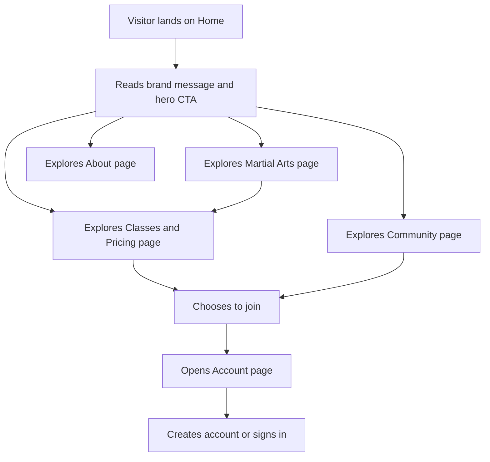

## 1. Product Overview
DoBu Martial Arts needs a bold, responsive multi-page website that promotes the gym, explains its services, and supports member-oriented interactions.
- The website should help prospective members understand the gym's martial arts offering, class schedules, pricing, facilities, and community value.
- The product supports brand promotion, lead generation, membership interest, and lightweight account/community engagement for the gym.

## 2. Core Features

### 2.1 User Roles
| Role | Registration Method | Core Permissions |
|------|---------------------|------------------|
| Visitor | No registration required | Browse pages, review classes, view prices, read community highlights |
| Member | Email-based account form | Create account, review membership summary, manage profile details |

### 2.2 Feature Module
1. **Home**: hero banner, brand highlights, facility overview, calls to action
2. **Martial Arts**: discipline cards, training benefits, instructor highlights, facilities overview
3. **Classes & Pricing**: class timetable overview, membership tiers, pricing table, join prompts
4. **About**: gym story, mission, values, facilities, trainer credibility
5. **Account**: sign up and sign in interface, profile summary, membership management placeholders
6. **Community**: testimonials, events, forum preview, social media integration area

### 2.3 Page Details
| Page Name | Module Name | Feature description |
|-----------|-------------|---------------------|
| Home | Hero section | Full-width impact banner with martial arts background image, strong tagline, and CTA buttons for joining and viewing classes |
| Home | Highlights strip | Quick facts for training types, facilities, expert coaching, and community value |
| Home | Featured programs | Visual summary of martial arts, fitness, and self-defence offerings |
| Home | Conversion block | Encourage membership sign-up with strong promotional messaging |
| Martial Arts | Discipline grid | Present martial arts offered by the gym with descriptions and benefits |
| Martial Arts | Facilities section | Showcase matted dojo area, gym equipment, sauna, steam room, and changing facilities |
| Martial Arts | Instructor credibility | Reinforce trust with experienced-coach messaging and training quality points |
| Classes & Pricing | Class schedule overview | Display available class categories and training sessions in a readable layout |
| Classes & Pricing | Pricing cards | Show pricing tiers and what each plan includes |
| Classes & Pricing | Membership CTA | Direct users to account creation or contact actions |
| About | Story and mission | Explain the gym's purpose, values, and customer promise |
| About | Gym environment | Describe the training atmosphere and student support approach |
| Account | Registration form | Allow users to create an account to manage membership details |
| Account | Sign-in panel | Provide returning member login form and membership summary area |
| Account | Membership dashboard preview | Show a static mockup of profile, selected membership, and next action buttons |
| Community | Testimonials | Present reviews and success stories from members |
| Community | Events and forum preview | Promote workshops, challenges, and community discussions |
| Community | Social integration | Link to social channels and encourage participation |

## 3. Core Process
Visitors arrive on the home page, learn about the gym, explore martial arts and pricing details, and then move into account creation or contact actions. Existing members can use the account page to view membership-related information, while community-driven users can explore testimonials, events, and social engagement areas before deciding to join.

## 4. User Interface Design
### 4.1 Design Style
- Primary colors: deep black, fight-night red, crisp white, with warm gray accents for secondary surfaces
- Button style: large, high-contrast, slightly angular buttons with energetic hover states
- Fonts and sizes: strong display font for headings paired with a highly readable sans-serif body font
- Layout style: desktop-first sections using bold hero composition, card grids, split layouts, and stacked mobile modules
- Icon style suggestions: clean line icons with combat-sport energy, social icons in circular or outlined treatments

### 4.2 Page Design Overview
| Page Name | Module Name | UI Elements |
|-----------|-------------|-------------|
| Home | Hero section | Background image, dark overlay, bold heading, supporting text, two CTA buttons, animated entrance states |
| Home | Highlights strip | Statistic cards, icon blocks, accent borders, responsive flex layout |
| Martial Arts | Discipline grid | Image-backed cards, red accent tags, hover elevation, readable copy blocks |
| Classes & Pricing | Pricing cards | Tiered cards, badges, feature lists, contrast callouts, comparison-friendly spacing |
| About | Story layout | Editorial split sections, strong headline hierarchy, facility callout panels |
| Account | Forms and dashboard | Clean form fields, strong focus states, membership summary card, responsive two-column desktop layout |
| Community | Social and testimonial modules | Review cards, event timeline, community posts preview, embedded-style social link section |

### 4.3 Responsiveness
- Use a desktop-first layout system with graceful adaptation for tablets and phones
- Build sections with CSS Grid and Flexbox for flexible reflow across breakpoints
- Collapse navigation into a mobile menu for small screens
- Stack pricing cards, feature blocks, and footer columns vertically on narrow devices
- Optimize spacing, tap targets, and readable font scaling for touch users
