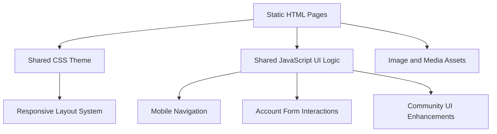

## 1. Architecture Design


## 2. Technology Description
- Frontend: HTML5 + CSS3 + Vanilla JavaScript
- Styling: Custom CSS with variables, Flexbox, CSS Grid, transitions, and media queries
- Assets: Local images and SVG/social icon assets as needed
- Deployment Model: Static multi-page site that can run directly in a browser or on any static hosting service

## 3. Route Definitions
| Route | Purpose |
|-------|---------|
| `/index.html` | Home page with hero banner, gym overview, featured services, and conversion CTAs |
| `/martial-arts.html` | Showcase martial arts disciplines, gym facilities, and training benefits |
| `/classes-pricing.html` | Present class categories, pricing options, and join prompts |
| `/about.html` | Explain the gym story, mission, facilities, and trust-building details |
| `/account.html` | Provide account creation, sign-in interface, and membership management preview |
| `/community.html` | Highlight testimonials, events, social engagement, and discussion-oriented content |

## 4. Component and File Strategy
| File | Responsibility |
|------|----------------|
| `index.html` | Home page content and conversion-focused landing experience |
| `martial-arts.html` | Martial arts offering content and facilities presentation |
| `classes-pricing.html` | Classes, plans, and pricing comparison content |
| `about.html` | Brand story and business credibility content |
| `account.html` | Registration, login, and member summary layout |
| `community.html` | Social proof, event content, and community participation layout |
| `assets/css/styles.css` | Shared design system, layout utilities, page sections, and responsive rules |
| `assets/js/main.js` | Navigation toggle, active link handling, lightweight page interactions, and form feedback |
| `assets/images/` | Hero image, feature imagery, and supporting visual assets |

## 5. Interaction Definitions
- Mobile menu toggle opens and closes the navigation on small screens
- Active navigation styling reflects the current page for orientation
- CTA buttons link between pages to support user flow from discovery to action
- Account forms use client-side JavaScript for basic validation and submission feedback
- Community sections can include interactive tabs or expandable cards without requiring backend services

## 6. Data Model
### 6.1 Client-Side Data Shape
```javascript
const membershipPlans = [
  {
    name: "Starter",
    price: "From GBP 35/month",
    features: ["Gym access", "Beginner classes", "Community access"]
  }
];

const classCategories = [
  {
    title: "Martial Arts Fundamentals",
    level: "Beginner to intermediate",
    focus: "Technique, discipline, conditioning"
  }
];
```

### 6.2 Content Strategy
- Use static content arrays in JavaScript only where repeating cards improve maintainability
- Keep essential SEO content directly in HTML for accessibility and strong baseline rendering
- Avoid backend dependencies for the initial version while leaving the account page structure ready for future integration

## 7. Responsiveness and Accessibility
- Use semantic landmarks such as `header`, `nav`, `main`, `section`, and `footer`
- Ensure keyboard focus states are visible across navigation, buttons, and forms
- Maintain strong color contrast for the black, red, and white brand palette
- Use fluid media, scalable typography, and layout breakpoints for tablet and mobile devices
- Prefer performant CSS effects over heavy JavaScript animations
